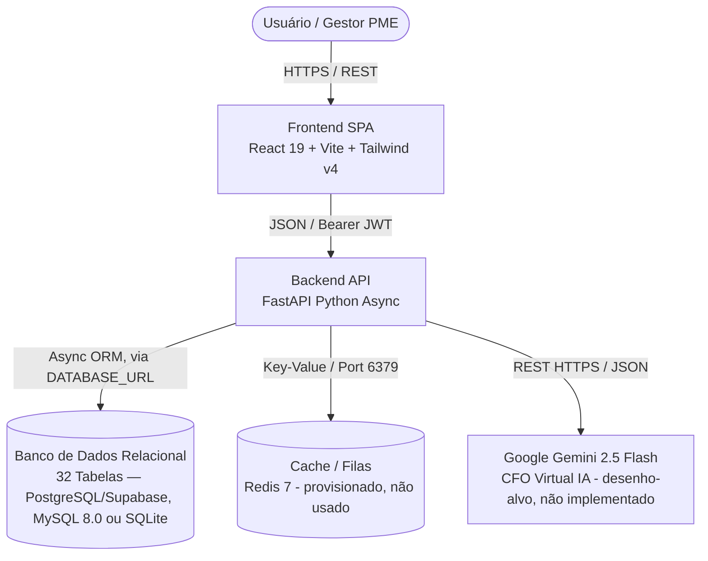
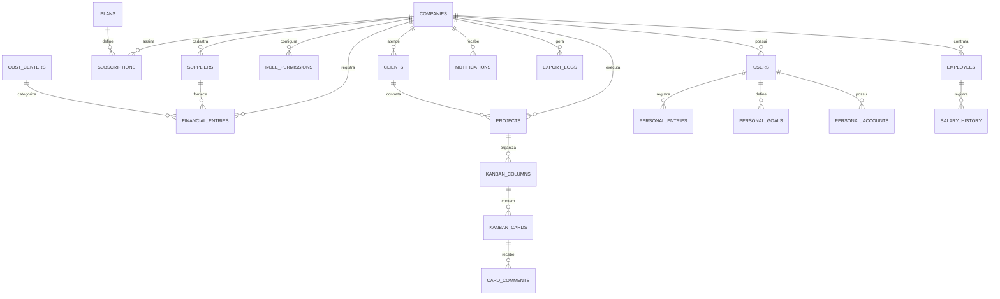

# Documento de Arquitetura de Software (DAS) — TechConnect 2.0

Este documento descreve a arquitetura do TechConnect 2.0: as decisões de design, os modelos de integração, o fluxo de dados, a segurança e os componentes de software do sistema.

---

## 1. Contexto técnico e visão geral

O TechConnect 2.0 usa uma arquitetura em camadas desacopladas — SPA no frontend, API REST assíncrona no backend, banco relacional e cache — o que permite escalar cada camada de forma independente e dá espaço para os módulos operacionais e de IA do sistema.

### 1.1 Diagrama de Contexto (C4 - Nível 1 & 2)

---

## 2. Componentes da solução

### 2.1 Frontend (SPA)

O frontend é React 19 com TypeScript, empacotado pelo Vite. O roteamento usa React Router v7, com lazy loading, rotas aninhadas para cada hub (`/`, `/dashboard`, `/kanban`, `/financeiro`, `/equipe`, `/fornecedores`, `/ia`, `/pessoal/:tab`) e guards de autenticação, módulo e escopo do plano. A interface segue o design system Obsidian Flow — glassmorphism, dark theme nativo, Framer Motion nas micro-interações, tipografia Inter e Outfit.

As requisições passam por interceptors do Axios, que injetam o token JWT automaticamente e encerram a sessão em respostas 401. Os gráficos (DRE, fluxo de caixa D+90, despesas por categoria, metas) são feitos com Recharts.

### 2.2 Backend (API assíncrona)

O backend é FastAPI (Python 3.11+), com validação via Pydantic v2, sobre SQLAlchemy 2.0 em modo assíncrono (`async_sessionmaker`, `select`, `update`, `delete`). Autenticação, checkout e permissões possuem schemas Pydantic; parte dos CRUDs ainda recebe dicionários e demanda ampliação da validação tipada. A autenticação é stateless, via JWT com HS256, e as senhas usam hash Bcrypt (Passlib).

As rotas ficam divididas por domínio em `app/api/v1/endpoints/`:
- `auth.py` — login, registro, refresh de token e dados do usuário atual.
- `financial.py` — lançamentos financeiros, DRE consolidado e fluxo D+90.
- `kanban.py` — projetos, colunas, cards, comentários, cronômetro e cálculo de *Cost-per-Task*.
- `employees.py` — colaboradores, cálculo de CTC e histórico salarial.
- `suppliers.py` — fornecedores, com integridade referencial.
- `clients.py` — clientes e vínculo a projetos.
- `ai.py` — execução dos POPs de IA (CFO Virtual, Conciliação, Orçamentos).
- `personal.py` — persistência dos 10 módulos do Hub Pessoal.
- `exports.py` — geração de relatórios e trilha de auditoria.
- `permissions.py` — matriz de permissões por cargo (`GET/PUT /permissions/matrix`) e módulos do usuário logado (`GET /permissions/mine`).
- `system.py` — status das integrações (`GET /system/integrations`).
- `company.py` — dados da empresa e conclusão do onboarding (`POST /company/onboarding/complete`).

### 2.3 Banco de dados e persistência

A estrutura relacional tem 32 tabelas gerenciadas pelo SQLAlchemy 2.0 assíncrono. Recursos empresariais possuem `company_id`, e as consultas e mutações operacionais aplicam o escopo da empresa autenticada; recursos do Hub Pessoal usam o `owner_id` do usuário autenticado. Assinaturas, faturas, calendários, preferências de notificação e timers ativos também são persistidos. A rotina `app/db/migrations.py` executa migrações aditivas idempotentes para bases anteriores, mas ainda não substitui uma ferramenta de migrations versionadas como Alembic.

O mesmo código aceita três dialetos diferentes por trás de uma única variável, `DATABASE_URL` (`app/db/session.py`): PostgreSQL (`postgresql+asyncpg://…`, hoje o padrão em `.env.example`, pensado para um banco gerenciado como o Supabase), MySQL 8.0 (`mysql+aiomysql://…`, via Docker Compose) ou SQLite (`sqlite+aiosqlite:///./techconnect.db`, usado como fallback quando `DATABASE_URL` não está definida) — ver [ADR 005](decisoes/adr-005-suporte-postgresql-supabase.md).

As chaves estrangeiras usam `ON DELETE SET NULL` nos relacionamentos não críticos, para evitar que uma exclusão em cascata apague lançamentos financeiros sem querer. O pool assíncrono mantém `pool_pre_ping=True` sempre ativo; `pool_recycle=280` só se aplica fora do Postgres, já que o pooler do Supabase cuida disso sozinho, e a conexão força `ssl=require` quando o dialeto é `postgresql`. O seed (`app/db/seed.py`) é idempotente e roda em qualquer um dos três bancos, inserindo empresa, usuários e dados iniciais sem duplicar nada. O catálogo de planos é sincronizado em `plans` quando uma assinatura é criada.

Um ponto de atenção: trocar de banco exige editar manualmente a `DATABASE_URL` no `.env` — não existe alternância automática entre a opção Docker (MySQL) e a opção gerenciada (Supabase). Subir o Compose sem editar essa linha faz o backend do container tentar conectar no Supabase em vez do MySQL local (item DB-5 do [BACKLOG](BACKLOG.md)).

---

## 3. Diagrama Entidade-Relacionamento (ERD Simplificado)

---

## 4. Arquitetura do módulo de IA (CFO Virtual e POPs)

A integração com o Gemini e a sanitização LGPD descritas abaixo são o desenho-alvo do módulo (itens IA-1 e SEC-2 do backlog); hoje ele responde por palavras-chave, sem nenhuma chamada externa. O desenho é o seguinte, uma vez implementado:

1. O backend extrai do banco relacional o DRE do período selecionado e as 10 tarefas do Kanban com maior desvio de custo (*Cost-per-Task* frente ao estimado).
2. Os nomes de colaboradores são trocados por "Colaborador A", "Colaborador B" etc., para não expor dado pessoal ao modelo (sanitização LGPD).
3. O template do POP é preenchido com essas métricas agregadas.
4. A chamada ao Gemini 2.5 Flash acontece via REST, com temperatura controlada e um schema JSON fixo de retorno (`CFOInsightResponse`).
5. Se a API do Gemini atingir um limite de uso ou ficar indisponível, o sistema registra o log e cai para uma análise baseada em regras locais, sem travar o resto do ERP.

---

## 5. Infraestrutura e Implantação (Docker Compose)

O `docker-compose.yml` orquestra 4 serviços locais:

| Serviço | Imagem / Build | Porta Interna | Porta Exposta | Função |
|---|---|---|---|---|
| `db` | `mysql:8.0` | 3306 | 3307 (host) | Persistência Relacional (opção Docker) |
| `redis` | `redis:7-alpine` | 6379 | 6379 (host) | Provisionado; ainda não utilizado pela aplicação |
| `backend` | `Dockerfile` (Python 3.11) | 8000 | 8000 | API FastAPI + SQLAlchemy |
| `frontend` | `Dockerfile` (Node 20 / Nginx) | 5173 / 80 | 5173 | Single Page Application |

O banco PostgreSQL gerenciado (Supabase) não é orquestrado pelo Compose — é um serviço externo, acessado via internet pela `DATABASE_URL`. Como o `backend` do Compose lê `DATABASE_URL=${DATABASE_URL}` diretamente do `.env` do host, subir o Compose sem trocar essa linha para o MySQL local faz o backend em Docker conectar no Supabase, não no `db` que o próprio Compose subiu (item DB-5).

---

## 6. Segurança e conformidade

### 6.0 Modelo de autorização por módulo

A autorização combina papel e módulo, decisão registrada na [ADR 004](decisoes/adr-004-permissoes-por-cargo-e-onboarding.md). Os módulos são `dashboard`, `kanban`, `equipe`, `financeiro`, `fornecedores`, `configuracoes`, `exportacao` e `ia`.

A fonte única de decisão é `get_allowed_modules(user, db)`, em `app/core/permissions.py`. O Admin recebe todos os módulos; para os demais cargos, valem as linhas de `role_permissions` (empresa × cargo × módulo) e, se a empresa ainda não tiver personalizado essa matriz (`permissions_customized = false`), o padrão do sistema — Gerente com tudo exceto `configuracoes`, Funcionário com `dashboard` e `kanban`. Uma empresa que já personalizou e não deixou nenhuma linha para um cargo simplesmente não libera módulo nenhum para ele.

No servidor, essa regra é aplicada pela dependência `require_module(chave)` em routers e endpoints. Kanban e clientes, equipe, fornecedores, exportações e IA são protegidos por módulo; Financeiro separa os endpoints completos dos endpoints de leitura do Dashboard. Sem permissão, a resposta é HTTP 403, e a busca (`/search`) também filtra resultados por módulo. No cliente, o hook `usePermissions` alimenta o menu (`Layout`) e as páginas, que redirecionam quem não tem acesso — mas o cliente só reflete o que o servidor decide, nunca é a barreira em si. Toda requisição exige `is_active`, e `GET/PUT /auth/users` ficam restritos ao Admin da mesma empresa, com papéis permitidos limitados a `GERENTE`/`FUNCIONARIO` e colunas sensíveis protegidas (`password_hash`, `company_id`, `id`).

No estado atual, os dados empresariais são filtrados por `company_id` e os dados pessoais por `owner_id`; Kanban e clientes exigem o módulo `kanban`, e o Hub Pessoal exige plano Pessoal ou Completo. Planos permanecem públicos para permitir consulta comercial, enquanto notificações ficam acessíveis a qualquer usuário autenticado da própria empresa.

Segredos como `SECRET_KEY`, `DATABASE_URL` e `GEMINI_API_KEY` devem ser injetados via `.env`, fora do Git. Essa regra foi violada uma vez: o commit `913f78d` (ver [ADR 005](decisoes/adr-005-suporte-postgresql-supabase.md)) colou valores reais no `README.md`; um commit seguinte trocou tudo por placeholders, mas a rotação das credenciais no Supabase segue pendente (SEC-5). Fora esse incidente, as senhas usam hash Bcrypt com salting automático e a autorização combina plano (`plan_scope`), papel e módulo. O Compose publica MySQL em `3307` e Redis em `6379` para desenvolvimento local; em produção essas portas não devem ser publicadas. O CORS é configurado por `CORS_ORIGINS`.

---

## 7. Referência para ADRs (Architecture Decision Records)

As justificativas técnicas detalhadas e os trade-offs considerados pela equipe estão formalizados em:
- [ADR 001: Adoção do FastAPI, SQLAlchemy 2.0 Async e MySQL 8.0](decisoes/adr-001-stack-fastapi-mysql-sqlalchemy.md)
- [ADR 006: Isolamento de Dados e Persistência Operacional](decisoes/adr-006-isolamento-e-persistencia-operacional.md)
- [ADR 002: Arquitetura de Hub Duplo com Controle por Plan Scope e RBAC](decisoes/adr-002-arquitetura-hub-duplo-plan-scope.md)
- [ADR 003: Design System Obsidian Flow e Stack Frontend (React 19 + Tailwind v4)](decisoes/adr-003-design-system-obsidian-flow.md)
- [ADR 004: Permissões por Cargo, Onboarding e Painel de Integrações](decisoes/adr-004-permissoes-por-cargo-e-onboarding.md)
- [ADR 005: Suporte a PostgreSQL Gerenciado (Supabase) como Banco Padrão](decisoes/adr-005-suporte-postgresql-supabase.md)
