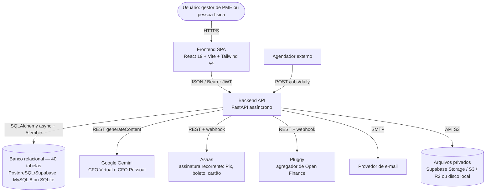
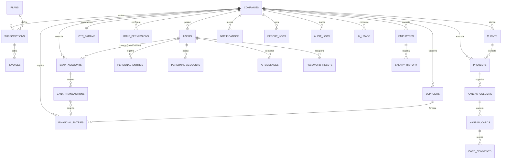

# Documento de Arquitetura de Software (DAS) — TechConnect 2.0

Este documento descreve a arquitetura do TechConnect 2.0: as decisões de design, os modelos de integração, o fluxo de dados, a segurança e os componentes de software do sistema. Estado de 07/10/2026.

---

## 1. Contexto técnico e visão geral

O TechConnect 2.0 usa uma arquitetura em camadas desacopladas: SPA no frontend, API REST assíncrona no backend e banco relacional. Cada serviço externo (IA, pagamentos, bancos, e-mail, arquivos) fica atrás de uma interface própria no backend, para que a troca de fornecedor não afete o resto do sistema, e cada um tem um modo de funcionamento sem credenciais para desenvolvimento.

### 1.1 Diagrama de Contexto (C4 — Níveis 1 e 2)

---

## 2. Componentes da solução

### 2.1 Frontend (SPA)

O frontend é React 19 com TypeScript, empacotado pelo Vite. O roteamento usa React Router v7, com guards de autenticação, aceite dos termos, onboarding, módulo e escopo do plano. As rotas públicas cobrem login, cadastro, planos, checkout, recuperação de senha, termos e privacidade. A interface segue o design system Obsidian Flow: glassmorphism, tema escuro, Framer Motion nas micro-interações, tipografia Inter e Outfit, e texto secundário com contraste WCAG AA.

O cliente HTTP (`src/api.ts`) injeta o token de acesso e, diante de um 401, renova a sessão uma única vez com o refresh token e repete a requisição; se não conseguir, encerra a sessão. Uma resposta 402 com o cabeçalho `X-Subscription: blocked` leva a pessoa para Assinatura. Os tipos das respostas da API ficam em `src/types.ts`; o ESLint roda sem erros e há testes com Vitest e Testing Library.

### 2.2 Backend (API assíncrona)

O backend é FastAPI (Python 3.11+), com Pydantic v2 e SQLAlchemy 2.0 assíncrono. São 173 rotas, divididas por domínio em `app/api/v1/endpoints/`:

| Arquivo | Responsabilidade |
| --- | --- |
| `auth.py` | Cadastro (com aceite dos termos e início do teste), login com bloqueio por tentativas e segundo fator, refresh, troca e recuperação de senha, 2FA, gestão de acessos |
| `account.py` | Direitos do titular: exportar meus dados, excluir minha conta |
| `audit.py` | Consulta da trilha de auditoria (Admin) |
| `payments.py` | Checkout, assinatura, cobranças, cancelamento, consumo do plano e webhook do Asaas |
| `bank.py` / `bank_hooks.py` | Contas, importação de extrato, conciliação, regras, agregador; webhook da Pluggy e sincronização agendada |
| `financial.py` | Lançamentos, comprovantes, DRE e fluxo de caixa D+90 |
| `kanban.py`, `clients.py` | Projetos, colunas, cartões, comentários, cronômetro e Cost-per-Task |
| `employees.py` | Colaboradores, CTC e histórico salarial |
| `suppliers.py` | Fornecedores |
| `exports.py` | Relatórios em CSV, JSON, XLSX e PDF |
| `ai.py`, `personal.py` | IA empresarial e Hub Pessoal (incluindo os insights do CFO Pessoal) |
| `company.py`, `permissions.py`, `system.py` | Empresa, parâmetros de CTC, calendário, onboarding, matriz de permissões, painel de integrações e versão dos termos |

As regras transversais ficam em `app/core/`:

| Módulo | Responsabilidade |
| --- | --- |
| `security.py`, `passwords.py`, `crypto.py`, `rate_limit.py` | Autenticação, política de senha, criptografia de segredos e limite por IP |
| `permissions.py`, `billing.py`, `plans.py` | Autorização por módulo, acesso por assinatura e limites do plano |
| `audit.py`, `notify.py`, `mailer.py` | Auditoria, notificações e e-mail |
| `storage.py`, `ctc.py`, `legal.py`, `readiness.py` | Arquivos privados, cálculo de CTC, versão dos termos e diagnóstico de configuração |

As integrações externas ficam em `app/integrations/` (`ai/`, `bank/`, `payments/`).

### 2.3 Banco de dados e persistência

A estrutura relacional tem 40 tabelas. Recursos empresariais têm `company_id`; recursos do Hub Pessoal (inclusive contas e movimentações bancárias pessoais) têm `owner_id`. Nenhuma coluna de dono tem valor padrão: um código que esqueça de preenchê-la falha, em vez de gravar dados na conta demo.

O schema é versionado com Alembic (`app/db/alembic/`, 10 revisões). Na inicialização:
- um banco vazio é criado pelas migrações;
- um banco anterior ao Alembic recebe as colunas de compatibilidade, é marcado na revisão base e atualizado;
- os demais recebem `upgrade head`.

Um teste falha se os models divergirem das migrações ([ADR 007](decisoes/adr-007-endurecimento-autenticacao-migracoes-auditoria.md)).

O mesmo código roda sobre PostgreSQL (Supabase), MySQL 8 e SQLite, escolhidos pela `DATABASE_URL`. A suíte de testes passa nos três ([ADR 005](decisoes/adr-005-suporte-postgresql-supabase.md)). No Docker Compose, o backend usa o MySQL do próprio Compose, salvo se `COMPOSE_DATABASE_URL` apontar para outro banco. O seed de demonstração é idempotente, e `python -m app.db.demo_dates` traz as datas da demonstração para o dia de hoje.

---

## 3. Diagrama Entidade-Relacionamento (simplificado)

---

## 4. Integrações

### 4.1 IA (CFO Virtual e CFO Pessoal)

1. O backend monta um resumo agregado com dados reais (`app/integrations/ai/context.py`):
   - empresa: receitas e despesas pagas em 30 e 90 dias, contas a pagar e a receber dos próximos 30 dias, vencidos, principais categorias, custo da equipe, movimentações sem conciliação;
   - pessoa: saldos, dívidas, orçamento × gasto, assinaturas, metas.

   O resumo não inclui CPF, e-mails nem nomes de colaboradores; descrições de lançamentos podem aparecer.
2. A chamada ao Gemini (`generateContent`) usa instrução de sistema que proíbe inventar números e, para insights, categorias e orçamentos, pede JSON, que é validado.
3. Sem chave, com erro, com saída inválida ou com a cota do plano esgotada, a resposta vem de regras calculadas sobre o mesmo resumo (`rules.py`), marcada como `source: "regra"`. O gerador de orçamentos é a exceção: sem modelo, ele responde 503.
4. Cada chamada real ao modelo conta na cota mensal da empresa (`ai_usage`), e o chat guarda o histórico em `ai_messages` ([ADR 009](decisoes/adr-009-ia-generativa-com-dados-reais.md)).

### 4.2 Bancos e conciliação

Extratos OFX (1.x e 2.x) e CSV são lidos por um parser tolerante às variações dos bancos brasileiros; o agregador (Pluggy) fica atrás de `BankProvider`. Cada movimentação tem um id externo único por conta, então reimportar não duplica. A conciliação automática só dá baixa quando há exatamente um lançamento pendente de mesmo tipo e valor com vencimento a até 5 dias. A sincronização acontece por botão, pelo webhook da Pluggy ou pela rota do agendador, e não gasta chamadas do agregador com empresas inadimplentes ([ADR 008](decisoes/adr-008-integracao-bancaria-e-conciliacao.md)).

### 4.3 Assinatura e cobrança

O checkout cria a assinatura recorrente no Asaas (`PaymentProvider`) e devolve o link da página de pagamento do Asaas: o TechConnect nunca recebe dados de cartão. O webhook autenticado por token confirma pagamentos e renova o período, marca atrasos e registra estornos. O acesso é decidido em `app/core/billing.py`:

| Situação da assinatura | Dá acesso até |
| --- | --- |
| Teste (7 dias) | o fim do teste |
| Ativa | o fim do período + 5 dias |
| Atrasada | 5 dias após o vencimento da cobrança mais antiga |
| Cancelada | o fim do período já pago |
| Aguardando o primeiro pagamento | não dá acesso por si só |

Sem acesso, os módulos respondem 402, mas Assinatura, Planos, Minha Conta e a autenticação continuam abertos. Sem credenciais do Asaas, um provedor simulado confirma na hora, e só fora de produção ([ADR 010](decisoes/adr-010-cobranca-recorrente-e-acesso-por-assinatura.md)).

### 4.4 E-mail e arquivos

O e-mail sai por SMTP genérico; sem configuração, fica só no log. Os e-mails de segurança (senha alterada, conta bloqueada, 2FA) ignoram a preferência de notificação. Anexos e exportações ficam em armazenamento privado, no disco local ou em qualquer serviço S3 compatível, e são servidos apenas por rotas autenticadas que conferem a empresa dona.

---

## 5. Infraestrutura e implantação

O `docker-compose.yml` orquestra 4 serviços locais:

| Serviço | Imagem / Build | Porta exposta | Função |
| --- | --- | --- | --- |
| `db` | `mysql:8.0` | 3307 | Banco relacional (opção Docker) |
| `redis` | `redis:7-alpine` | 6379 | Provisionado; não usado pela aplicação |
| `backend` | `Dockerfile` (Python 3.11) | 8000 | API FastAPI |
| `frontend` | `node:20-alpine` | 5173 | SPA em modo desenvolvimento |

Para produção, um ambiente comercial típico tem:
- PostgreSQL gerenciado (Supabase);
- armazenamento S3 compatível (`STORAGE_BACKEND=s3`);
- backend atrás de um proxy (`TRUSTED_PROXY_HOPS=1`), com `APP_ENV=production`;
- os webhooks do Asaas e da Pluggy apontados para a API;
- um agendador diário chamando `/api/v1/jobs/daily`, que gera os alertas de vencimento e sincroniza os bancos.

Em produção, o backend registra no log tudo o que falta configurar, e o Admin vê o mesmo diagnóstico em Configurações → Conexões de API.

O CI (`.github/workflows/ci.yml`) roda a cada pull request:
- backend: `pytest` em SQLite e em PostgreSQL;
- frontend: lint, testes e build.

---

## 6. Segurança e conformidade

### 6.1 Autorização

A autorização combina plano (`plan_scope`), assinatura ativa, papel e módulo ([ADR 004](decisoes/adr-004-permissoes-por-cargo-e-onboarding.md)). A fonte única dos módulos é `get_allowed_modules`, em `app/core/permissions.py`: o Admin tem todos; os demais seguem a matriz `role_permissions` da empresa ou o padrão. No servidor, `require_module` responde 403 e `require_active_subscription` responde 402; o cliente só reflete essas decisões. Dados empresariais são filtrados por `company_id` e pessoais por `owner_id`, inclusive nas rotas de bancos, IA e auditoria. Testes atacam cada recurso a partir de outra empresa e de outro usuário.

### 6.2 Autenticação

| Controle | Como funciona |
| --- | --- |
| Senha | 8+ caracteres, com letras e números; hash Bcrypt |
| Bloqueio | 15 minutos após 5 falhas (senha ou código), com e-mail de aviso |
| Limite por IP | Janela deslizante nas rotas de autenticação; `X-Forwarded-For` só é considerado atrás de proxy confiável |
| Tokens | Acesso de 60 minutos e renovação de 7 dias, ambos com a impressão da senha: trocar ou redefinir a senha revoga as sessões antigas |
| Verificação em duas etapas | TOTP, com o segredo criptografado por `ENCRYPTION_KEY`, e 8 códigos de recuperação guardados como hash |
| Recuperação de senha | Token de uso único, válido por 1 hora, guardado só como hash; a resposta não revela se o e-mail existe |

### 6.3 Privacidade (LGPD) e auditoria

- O cadastro exige o aceite versionado dos termos e da política; quem não aceitou a versão vigente aceita no próximo acesso.
- Em Minha Conta, o titular baixa os próprios dados e exclui a conta. A exclusão do único usuário apaga a empresa inteira, inclusive os arquivos.
- A trilha `audit_logs` registra ações sensíveis com usuário, data e IP.
- Os textos legais são minuta e precisam de revisão jurídica.

### 6.4 Segredos

Segredos ficam no `.env`, fora do Git, e o `.env.example` lista todas as variáveis. Essa regra foi violada uma vez: o commit `913f78d` colou valores reais no `README.md`. Os valores foram trocados por placeholders depois, mas continuam válidos no histórico, e a chave do Gemini foi bloqueada pelo Google como vazada. A troca das credenciais é pré-requisito do lançamento (SEC-5).

---

## 7. Referência para ADRs (Architecture Decision Records)

As justificativas técnicas e os trade-offs considerados estão em:
- [ADR 001: Adoção do FastAPI, SQLAlchemy 2.0 Async e MySQL 8.0](decisoes/adr-001-stack-fastapi-mysql-sqlalchemy.md)
- [ADR 002: Arquitetura de Hub Duplo com Controle por Plan Scope e RBAC](decisoes/adr-002-arquitetura-hub-duplo-plan-scope.md)
- [ADR 003: Design System Obsidian Flow e Stack Frontend (React 19 + Tailwind v4)](decisoes/adr-003-design-system-obsidian-flow.md)
- [ADR 004: Permissões por Cargo, Onboarding e Painel de Integrações](decisoes/adr-004-permissoes-por-cargo-e-onboarding.md)
- [ADR 005: Suporte a PostgreSQL Gerenciado (Supabase) como Banco Padrão](decisoes/adr-005-suporte-postgresql-supabase.md)
- [ADR 006: Isolamento de Dados e Persistência Operacional](decisoes/adr-006-isolamento-e-persistencia-operacional.md)
- [ADR 007: Endurecimento de Autenticação, Migrações Versionadas e Auditoria](decisoes/adr-007-endurecimento-autenticacao-migracoes-auditoria.md)
- [ADR 008: Integração Bancária por Agregador e Conciliação](decisoes/adr-008-integracao-bancaria-e-conciliacao.md)
- [ADR 009: IA Generativa sobre Dados Reais, com Fallback por Regras e Cota](decisoes/adr-009-ia-generativa-com-dados-reais.md)
- [ADR 010: Cobrança Recorrente e Acesso por Assinatura](decisoes/adr-010-cobranca-recorrente-e-acesso-por-assinatura.md)
- [ADR 011: Recuperação de Conta, Verificação em Duas Etapas, Consentimento e Armazenamento Privado](decisoes/adr-011-conta-2fa-consentimento-armazenamento.md)
