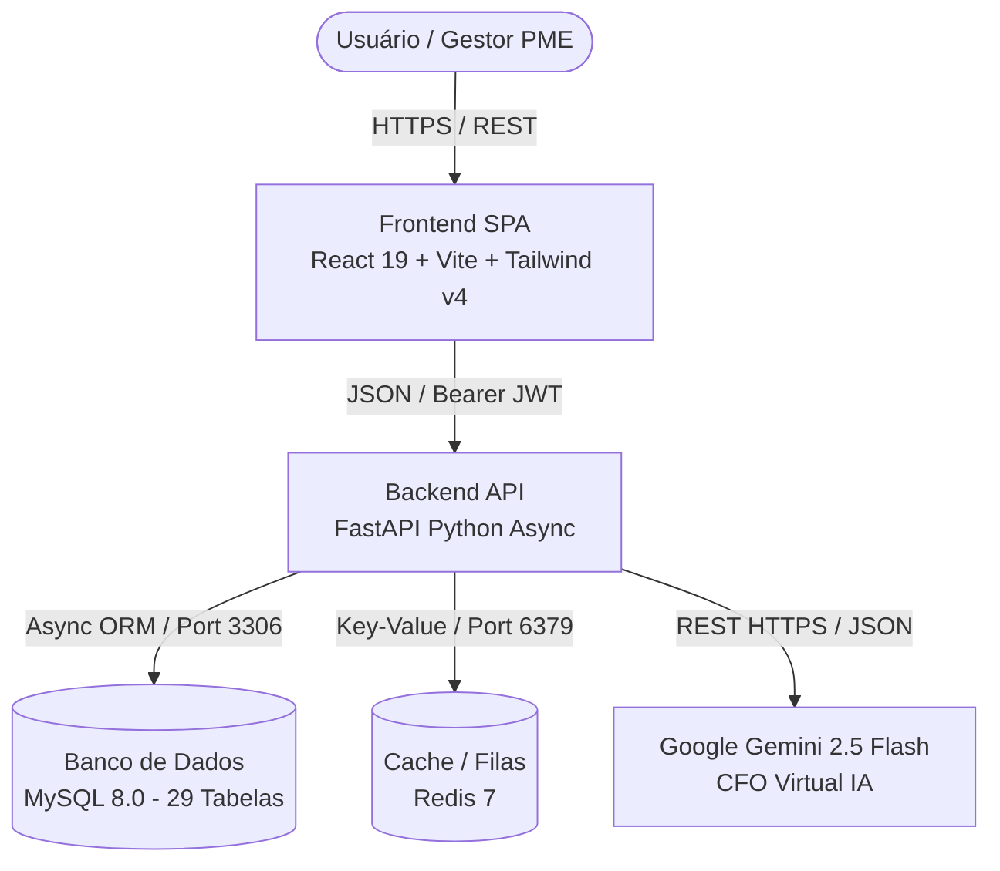
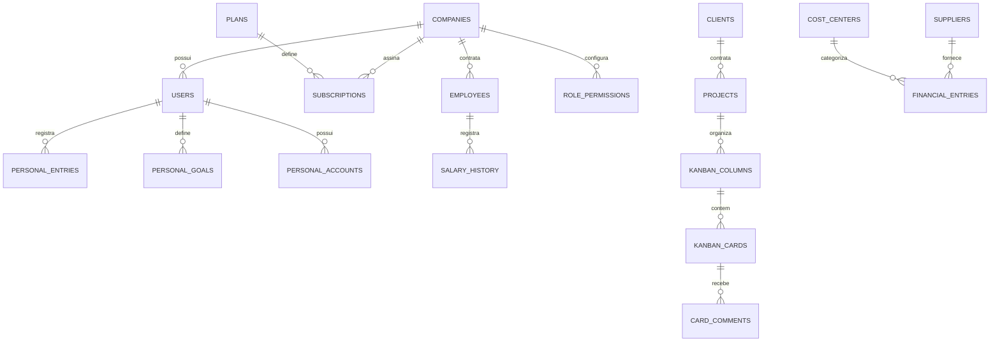

# Documento de Arquitetura de Software (DAS) — TechConnect 2.0

Este documento apresenta a especificação arquitetural do **TechConnect 2.0**, descrevendo as decisões de design, modelos de integração, fluxo de dados, segurança e visão de componentes de software do sistema.

---

## 1. Contexto Técnico e Visão Geral

O **TechConnect 2.0** adota uma arquitetura em camadas desacoplada (Single Page Application + API REST Assíncrona + Banco Relacional + Cache), projetada para oferecer altíssima performance, escalabilidade horizontal e suporte a múltiplos módulos operacionais e de inteligência artificial.

### 1.1 Diagrama de Contexto (C4 - Nível 1 & 2)

---

## 2. Componentes da Solução

### 2.1 Frontend (SPA Web)
- **Framework & Runtime:** React 19 com TypeScript e bundler Vite.
- **Roteamento:** React Router v7 com lazy loading e rotas aninhadas para os hubs (`/`, `/dashboard`, `/kanban`, `/financeiro`, `/equipe`, `/fornecedores`, `/ia`, `/pessoal/:tab`).
- **Design System:** *Obsidian Flow* (Glassmorphism, Dark Theme nativo, Framer Motion para micro-interações, tipografia Inter e Outfit).
- **Gerenciamento de Estado & Requisições:** Axios com interceptors para injeção automática de token JWT e tratamento centralizado de erros de autorização.
- **Visualização de Dados:** Recharts para gráficos de DRE, fluxo de caixa projetado D+90, distribuição de despesas e metas financeiras.

### 2.2 Backend (API RESTful Assíncrona)
- **Framework:** FastAPI (Python 3.11+) com validação estrita via esquemas Pydantic v2.
- **Camada ORM:** SQLAlchemy 2.0 em modo assíncrono (`async_sessionmaker`, `select`, `update`, `delete`).
- **Autenticação & Segurança:** Autenticação stateless via JSON Web Token (JWT) com algoritmo HS256 e hash de senhas Bcrypt (Passlib).
- **Roteamento Modular:** Arquitetura dividida em routers de domínio sob `app/api/v1/endpoints/`:
  - `auth.py`: Login, registro, token refresh e dados do usuário atual.
  - `financial.py`: Lançamentos financeiros, DRE consolidado e fluxo D+90.
  - `kanban.py`: Projetos, colunas, cards, comentários, cronômetro e cálculo de *Cost-per-Task*.
  - `employees.py`: Colaboradores, cálculo de CTC e histórico salarial.
  - `suppliers.py`: Gestão de fornecedores com integridade referencial.
  - `clients.py`: Gestão de clientes e vínculo a projetos.
  - `ai.py`: Execução dos POPs de inteligência artificial (CFO Virtual, Conciliação, Orçamentos).
  - `personal.py`: Rotas de persistência de todos os 10 módulos do Hub Pessoal.
  - `exports.py`: Geração de relatórios e trilha de auditoria.
  - `permissions.py`: Matriz de permissões por cargo (`GET/PUT /permissions/matrix`) e módulos do usuário logado (`GET /permissions/mine`).
  - `system.py`: Status das integrações (`GET /system/integrations`).
  - `company.py`: Dados da empresa e conclusão do onboarding (`POST /company/onboarding/complete`).

### 2.3 Banco de Dados & Persistência (MySQL 8.0)
- Estrutura relacional normalizada com 29 tabelas gerenciadas pelo SQLAlchemy.
- Mecanismo de integridade com chaves estrangeiras (`ON DELETE SET NULL` em relacionamentos não-críticos para evitar deleção em cascata acidental de lançamentos financeiros).
- Pool assíncrono otimizado com `pool_pre_ping=True` e `pool_recycle=3600` para evitar conexões inativas ou expiradas no contêiner.
- Rotina de **Seed Idempotente** (`app/db/seed.py`) que insere planos padrão, usuário administrador e dados iniciais sem duplicidade.

---

## 3. Diagrama Entidade-Relacionamento (ERD Simplificado)

---

## 4. Arquitetura do Módulo de IA (CFO Virtual & POPs)

> **Estado atual:** a integração com o Gemini e a sanitização LGPD abaixo são o **desenho-alvo** (IA-1, SEC-2). Hoje o módulo responde por palavras-chave, sem chamada externa.

O módulo de IA opera sob **Procedimentos Operacionais Padrão (POPs)** determinísticos antes e depois da chamada ao LLM:

1. **Coleta e Agregação:** O backend extrai do MySQL o DRE do período selecionado e as 10 tarefas do Kanban com maior desvio de custo (*Cost-per-Task* vs Estimado).
2. **Sanitização (LGPD):** Os nomes de colaboradores são ofuscados para "Colaborador A", "Colaborador B", garantindo conformidade e proteção de dados sensíveis.
3. **Construção do Prompt Estruturado:** O template do POP é preenchido com as métricas agregadas.
4. **Chamada ao Gemini 2.5 Flash:** Comunicação via API REST com temperatura controlada e schema JSON estrito de retorno (`CFOInsightResponse`).
5. **Fallback Gracioso:** Caso a API atinja limites ou fique indisponível, o sistema registra o log e apresenta análise baseada em regras determinísticas locais sem interromper o ERP.

---

## 5. Infraestrutura e Implantação (Docker Compose)

O sistema é 100% contêinerizado e orquestrado via `docker-compose.yml`:

| Serviço | Imagem / Build | Porta Interna | Porta Exposta | Função |
|---|---|---|---|---|
| `db` | `mysql:8.0` | 3306 | 3307 (host) | Persistência Relacional |
| `redis` | `redis:7-alpine` | 6379 | 6379 (host) | Provisionado; ainda não utilizado pela aplicação |
| `backend` | `Dockerfile` (Python 3.11) | 8000 | 8000 | API FastAPI + SQLAlchemy |
| `frontend` | `Dockerfile` (Node 20 / Nginx) | 5173 / 80 | 5173 | Single Page Application |

---

## 6. Segurança e Conformidade

### 6.0 Modelo de Autorização por Módulo
A autorização combina **papel** e **módulo** (decisão em [ADR 004](decisoes/adr-004-permissoes-por-cargo-e-onboarding.md)):

- **Módulos:** `dashboard`, `kanban`, `equipe`, `financeiro`, `fornecedores`, `configuracoes`, `exportacao`, `ia`.
- **Fonte única:** `get_allowed_modules(user, db)` em `app/core/permissions.py`. `ADMIN` recebe todos os módulos; para os demais, valem as linhas de `role_permissions` (empresa × cargo × módulo) e, se a empresa ainda não personalizou (`permissions_customized = false`), o padrão do sistema (Gerente: tudo exceto `configuracoes`; Funcionário: `dashboard`, `kanban`); empresa personalizada sem linhas para o cargo = nenhum módulo.
- **Aplicação no servidor:** dependência `require_module(chave)` — em nível de router para `employees`, `suppliers`, `financial`, `exports` e `ai` (em `app/api/v1/api.py`) e por endpoint nas rotas que alteram a empresa. Sem permissão → HTTP 403. `/search` filtra resultados por módulo.
- **Aplicação no cliente:** hook `usePermissions` alimenta o menu (`Layout`) e as páginas, que redirecionam quem não tem o módulo. O cliente apenas reflete o servidor; nunca é a barreira.
- **Usuários:** `is_active` é exigido em toda requisição; `GET/PUT /auth/users` são restritos ao Admin da mesma empresa, com papéis permitidos `GERENTE`/`FUNCIONARIO` e colunas protegidas (`password_hash`, `company_id`, `id`).

**Limites conhecidos** (ver [BACKLOG](BACKLOG.md)): dados de negócio não são separados por empresa (MT-1); Hub Pessoal usa proprietário fixo em vez do usuário autenticado (MT-2); rotas de Kanban, clientes, notificações, planos, pagamentos e Hub Pessoal sem gate por módulo (SEC-3).

- **Gestão de Segredos:** Variáveis como `SECRET_KEY`, `DATABASE_URL` e `GEMINI_API_KEY` são injetadas estritamente via `.env` (ignorado no Git).
- **Proteção de Senhas:** Hashing unidirecional com Bcrypt e salting automático.
- **Autorização em Três Eixos:** filtro por plano (`plan_scope`), papel (`ADMIN`, `GERENTE`, `FUNCIONARIO`) e módulo liberado ao cargo (seção 6.0).
- **Segurança de Rede:** Serviços de banco e cache isolados na rede interna do Docker (`techconnect-net`), expondo apenas portas estritamente necessárias.

---

## 7. Referência para ADRs (Architecture Decision Records)

As justificativas técnicas detalhadas e os trade-offs considerados pela equipe estão formalizados em:
- [ADR 001: Adoção do FastAPI, SQLAlchemy 2.0 Async e MySQL 8.0](decisoes/adr-001-stack-fastapi-mysql-sqlalchemy.md)
- [ADR 002: Arquitetura de Hub Duplo com Controle por Plan Scope e RBAC](decisoes/adr-002-arquitetura-hub-duplo-plan-scope.md)
- [ADR 003: Design System Obsidian Flow e Stack Frontend (React 19 + Tailwind v4)](decisoes/adr-003-design-system-obsidian-flow.md)
- [ADR 004: Permissões por Cargo, Onboarding e Painel de Integrações](decisoes/adr-004-permissoes-por-cargo-e-onboarding.md)
